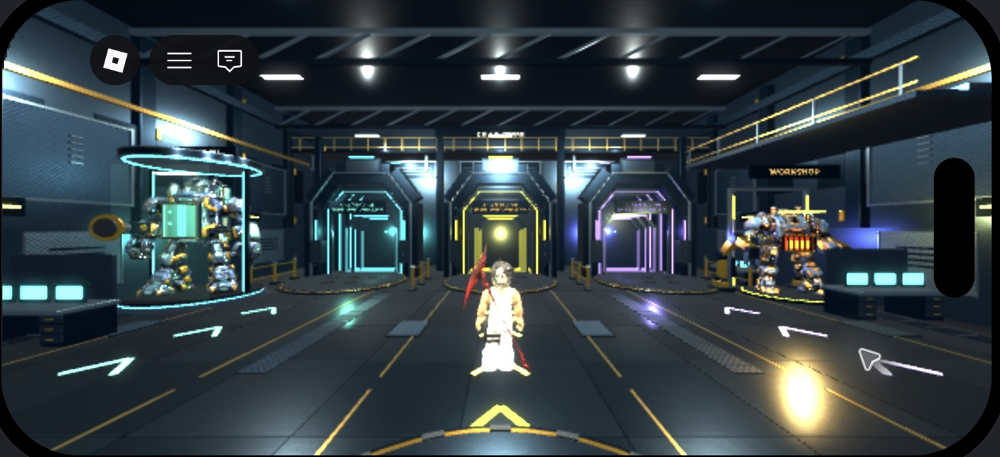

# Cria & Corre · laboratório de produto

**Da escolha de peças à decisão de produto: liberdade de criação com limites claros.**

Projeto pessoal de Walterlan Frazão, desenvolvido com apoio de IA. Este repositório apresenta um estudo do jogo **Cria & Corre** e um recorte executável do seu sistema de balanceamento em Luau.


*Captura real da revisão 0.52.0 no emulador do Roblox Studio. Não representa um teste em celular físico.*

[Experiência no Roblox](https://www.roblox.com/games/109849577193695/Cria-Corre) · [Perfil profissional](https://www.linkedin.com/in/walterlan-fraz%C3%A3o-7a94b168/)

## A proposta

Um jogador monta e pilota um robô; os demais precisam cooperar para escapar. A oficina combina corpo, movimento, poder, motor e tanque. Cada escolha altera peso, velocidade, consumo e autonomia.

O desafio de produto é tornar essas escolhas relevantes: adicionar peças mais fortes precisa trazer um custo compreensível, preservando oportunidades de fuga e cooperação.

## Meu papel

Concepção e direcionamento da experiência, definição de requisitos, avaliação das versões e solicitação de melhorias de interface e jogabilidade. A implementação, a documentação e a automação de testes foram desenvolvidas com assistência de IA. O projeto integra meu aprendizado prático em desenvolvimento de produtos digitais.

## Decisões representadas no código

| Decisão | Motivo | Evidência |
| --- | --- | --- |
| Limite de 60 kg por montagem | Criar uma restrição comum entre as combinações | `RobotBalance.stats` |
| Maior velocidade pode consumir mais combustível | Dar significado à escolha do motor | `Catalog.luau` e `RobotBalance.luau` |
| Consumo baseado no tempo decorrido | Evitar que a frequência de atualização altere a autonomia | `Balance.cli.luau` |
| Ação sem combustível suficiente não é cobrada | Manter previsibilidade para o jogador | `RobotBalance.spend` |
| Catálogo com identificadores estáveis | Preservar referências de montagens entre atualizações | `Catalog.normalize` |

## Executar os testes

Instale a ferramenta de linha de comando da [distribuição oficial do Luau](https://luau.org/getting-started/). Dentro da pasta do repositório, execute:

```sh
luau Balance.cli.luau
```

Resultado reproduzido em **03/11/2026**, com Luau 0.744:

```text
Cria & Corre balance: 16499 checks passed; 3022 legal recipes
```

O teste percorre **3.240 combinações**, das quais **3.022** respeitam o limite de peso. As verificações incluem limites de velocidade, consumo, ações sem saldo e diferenças entre montagens. Essas contagens medem regras automatizadas; não medem diversão, retenção ou equilíbrio entre pessoas.

## O que está neste repositório

- `Catalog.luau`: peças, atributos e validação da montagem.
- `RobotBalance.luau`: peso, velocidade, estimativa de autonomia e consumo.
- `Balance.cli.luau`: teste existente do projeto, adaptado apenas para os caminhos desta pasta e para a identificação do resultado.
- `lobby-mobile.png`: captura da experiência integrada.

Os dois módulos foram extraídos do código da versão 0.52.0. O jogo completo, seus modelos, serviços de salvamento e controles não fazem parte deste recorte. A revisão registrada do jogo foi publicada no Roblox em 27/10/2026; a disponibilidade para cada visitante depende das regras de acesso da plataforma.

## Próximas validações de produto

Testar compreensão das escolhas com jogadores, comparar montagens usadas, observar abandono da oficina e medir desempenho em celulares físicos. São próximos passos propostos, sem resultados de público ou métricas comerciais atribuídos a este portfólio.
